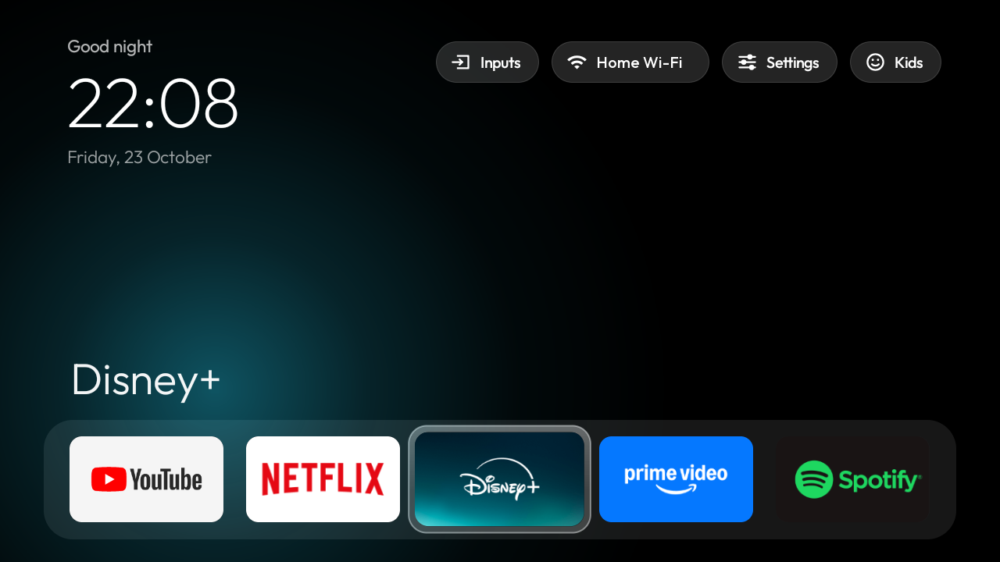
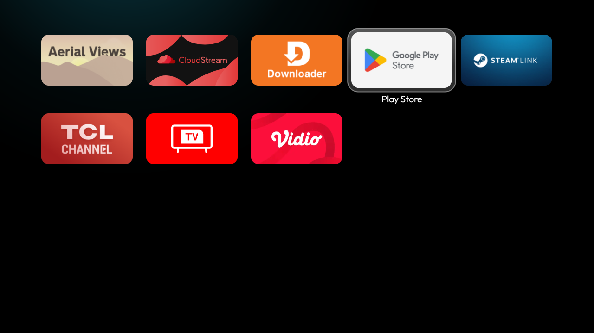
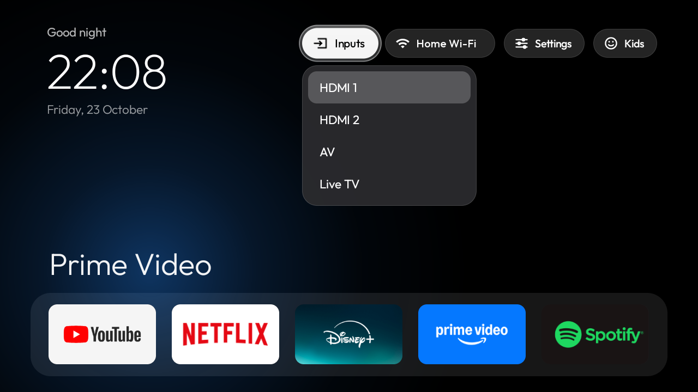
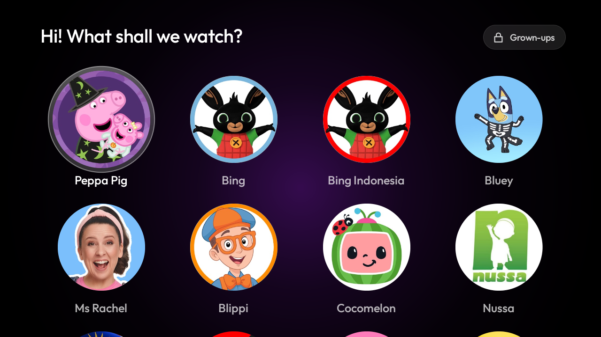

# Clean TV Home

A small, Apple TV–style home screen for Android TV, plus a Kids Mode and scripts to debloat the TV over ADB.



- **Dock** of your favourite apps in a soft band at the bottom, with the rest of your apps in a grid below.
  Pressing Down scrolls the grid up one row at a time.
- **One glass highlight** springs from tile to tile. The focused tile grows a little, and the focused dock
  app's name glows above the dock in a colour taken from its banner.
- **Clock, date and greeting** at the top left, in [Outfit](https://github.com/Outfitio/Outfit-Fonts) (OFL).
- **Top bar**: Inputs (HDMI / AV / Live TV through the TV input framework), Wi-Fi, Settings, Kids.
- **Kids Mode**: big round tiles that open a show's YouTube channel. Leaving it needs a parent PIN.
- Light by design: no blur, no video, no network polling. It runs on a 1 GB TV.

| Grid | Inputs | Kids Mode |
|---|---|---|
|  |  |  |

> Tested on a TCL A3 (Android TV 9, 720p). It should work on Android TV / Google TV 8.0 and newer, but
> nothing else has been tried yet. Issues and reports from other TVs are welcome.
> It does not work on Samsung (Tizen), LG (webOS) or Fire TV.

## Requirements

- An Android TV with **Developer options → USB debugging** (and Network debugging if your TV shows it) on,
  on the same network as your computer.
- `adb`, JDK 17 and the Android SDK (Android Studio installs both). Create `launcher/local.properties`
  with `sdk.dir=/path/to/Android/sdk`.

## Install

```sh
export TV_HOST=192.168.1.50      # your TV's IP
adb connect $TV_HOST:5555        # accept "Allow USB debugging?" on the TV
tools/kids-fetch.sh              # downloads the Kids Mode pictures
./install.sh                     # builds, installs, makes it the Home app
```

Press Home on the remote. If another launcher still opens, it is probably holding the Home key:
check `adb shell cmd package query-activities -a android.intent.action.MAIN -c android.intent.category.HOME`,
and disable the others (`tools/disable.sh <package>`, never the Settings `FallbackHome`).

## Configure

Everything lives in `launcher/app/src/main/res/values/`. Run `./install.sh` again after editing.

| File | Setting | What it does |
|---|---|---|
| `config.xml` | `dock_apps` | Dock apps, left to right, by package name (`adb shell pm list packages \| grep -i netflix`) |
| `config.xml` | `columns` | Tiles per row, 4–7 |
| `config.xml` | `hidden_apps` | Apps never shown in the grid |
| `config.xml` | `wallpaper_path` | Optional picture behind the home screen (dimmed); black if the file is missing |
| `kids.xml` | `kids_series` | Kids Mode tiles: `Name\|YouTube channel ID`. Run `tools/kids-fetch.sh` after changing |

Wallpaper: `adb push picture.jpg /sdcard/Pictures/launcher-wallpaper.jpg`, then press Home.

## Kids Mode

The **Kids** pill switches to a screen with only the series tiles; it stays on after Home and after a reboot.
The first time, it asks a grown-up to choose a 4-digit PIN. **Grown-ups** (top right) + PIN leaves it.
On the PIN pad: ▲▼ change the number, OK or ► next, ◄ back, Back cancels.

Forgot the PIN:

```sh
adb shell am force-stop tv.clean.launcher
adb shell "run-as tv.clean.launcher sed -i '/name=\"pin\"/d;/name=\"kids\"/d' shared_prefs/home.xml"
```

What it does not cover:
- **What plays inside YouTube.** Tiles open the channel in whichever YouTube profile is active. The old
  YouTube Kids app for TV is discontinued; use a **YouTube Kids profile inside the YouTube app**
  ("Who's watching?" → add a kid profile, then set a parent code in YouTube's settings).
- **The remote's app buttons** (Netflix, YouTube…), Settings and Input are handled by the TV's firmware
  and still work in Kids Mode.

## Debloat tools

| Script | Use |
|---|---|
| `tools/disable.sh pkg…` | `pm disable-user` one package at a time, refuses Android core packages, logs to `backup/disabled-by-us.txt` |
| `./restore.sh [pkg]` | Re-enables everything in that log (or one package) and gives Home back to the stock launcher |
| `tools/tv.py --screenshot out.png DPAD_DOWN` | Presses remote keys and pulls a screenshot from the TV |

Nothing is uninstalled; everything is reversible. Back up first:
`adb shell pm list packages -f > backup/packages.txt` and `adb shell settings list global > backup/settings-global.txt`
(and `secure`, `system`). [`docs/tcl-a3.md`](docs/tcl-a3.md) is a worked example: what was disabled on a
TCL A3, what was kept and why, and the firmware's quirks.

When you are done, switch USB debugging off again and revoke the authorisations: port 5555 is a plaintext shell.

## License

MIT. The Outfit font is under the SIL Open Font License (`launcher/OUTFIT-OFL.txt`).
Channel pictures are not included; `tools/kids-fetch.sh` downloads them from YouTube for your own use.
